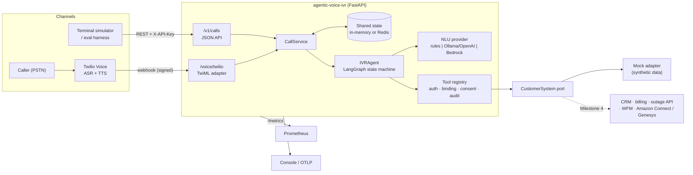
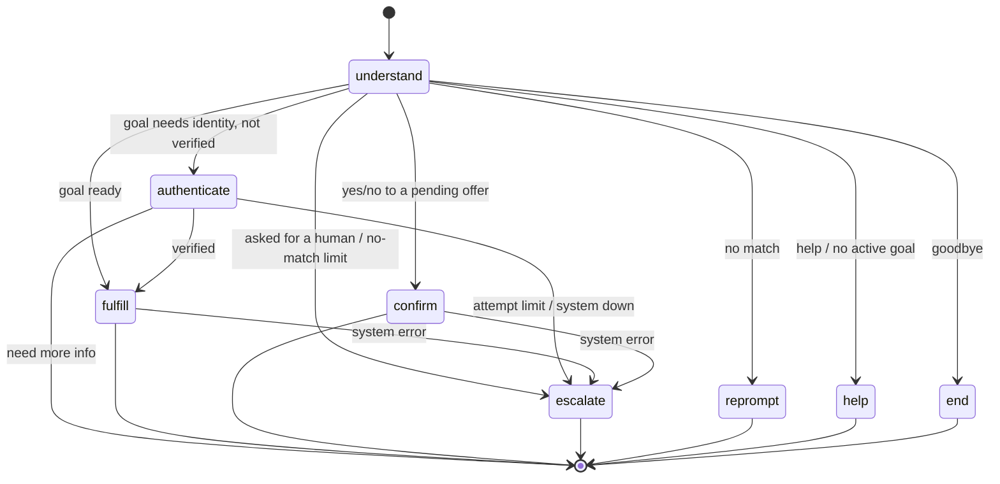

# agentic-voice-ivr

**An agentic conversational IVR that verifies callers, calls enterprise APIs, completes multi-step requests, and hands off to humans with full context — with every guardrail enforced in code, not in prompts.**

[](https://github.com/MarshalTakavinga/Agentic-Voice-AI/actions/workflows/ivr.yml)


Project 01 of the [**Agentic Voice AI**](../README.md) portfolio. Runs entirely on a laptop with no paid accounts.

---

## The problem

Most enterprise IVRs are DTMF trees ("press 1 for billing") built a decade ago. Callers zero-out to an agent, containment stays low, and every transfer starts cold: the agent asks for the account number the caller already keyed in. Bolting an LLM onto a phone line fixes the conversation but creates new risks — a model that can be talked into reading another customer's account, booking without consent, or trapping a caller who asks for a human.

This project is a reference implementation of the middle path: **natural conversation where it helps, deterministic control where it matters.**

## What it does (Milestone 1)

A caller to *Northwind Fiber* (a fictional ISP) can, by speech or keypad:

| Task | Needs identity? | Tools called |
|---|---|---|
| Check balance and due date | Yes | `verify_caller` → `get_account_balance` |
| Check for an outage (by ZIP, or their service address once verified) | No | `check_service_outage` |
| Schedule a technician, with explicit confirmation before booking | Yes | `find_technician_slots` → `book_technician_visit` |
| Reach a human at any point, with a warm-transfer context packet | No | `transfer_to_agent` |

It handles spoken digits ("one zero zero..."), volunteered information ("account 10000002, PIN 4321"), mid-call goal changes, declined offers, silence, unintelligible input, failed verification and downstream outages.

```text
IVR: Thanks for calling Northwind Fiber. You're speaking with an automated assistant. ...
YOU: I need a technician to come out
IVR: First I need to verify your account. Please say or enter your eight digit account number.
YOU: 10000002
IVR: Thanks. Now please say or enter your four digit PIN.
YOU: 4321
IVR: Thanks, Ben, you're verified. The earliest available technician visit is Monday, October 26
     between 8 AM and noon. Would you like me to book it?
YOU: how about friday
IVR: The earliest available technician visit is Friday, October 30 between 8 AM and noon. ...
YOU: yes
IVR: You're all set for Friday, October 30 between 8 AM and noon. Your confirmation number is N W 1 0 0 0 0 1.
```

## The Claude planner (Milestone 2)

The keyword rules handle most turns at zero cost. When they can't map what the caller said, for example *"my wifi keeps cutting out, could someone look at it friday"* or *"this is ridiculous"*, the agent can ask **Claude Haiku 5.5** to plan the turn with tool calling. The model never gets the keys:

| Guardrail | How it's enforced |
|---|---|
| **Least-privilege tools** | The planner sees four tools: `start_tasks`, `check_outage_in_area`, `get_my_balance`, `transfer_to_human`. None of them take an account number, PIN, customer ID, ZIP or slot. Identity and ZIP come from the verified session. Booking is not exposed; it stays in the deterministic flow with an explicit yes/no. |
| **Allowlist** | Any other tool name the model emits is refused (`tool_not_permitted`) and logged in the audit trail. |
| **Same registry checks** | `get_my_balance` still runs through `requires_auth` and customer binding. An unverified caller gets `authentication_required`. |
| **Redaction** | Digit runs in the caller's words become `[number]` before they're sent. The model is never called while digits are being collected. |
| **Grounded replies** | A reply is spoken only if every number in it came from a tool result this turn, and it makes no action or identity claim ("booked", "credited", "you're verified", "logged in as..."). Otherwise the rules reprompt is used. |
| **Fallback** | Timeout, HTTP error, bad output, an exhausted budget or a hit per-call cap all fall back to rules; the caller never hears an error. |

**Cost controls.** It uses the cheapest current model, Haiku 5.5 ($0.10 / $0.50 per million input/output tokens). Other controls:

* `max_tokens` is 200.
* Temperature is 0.
* The system prompt is cached.
* At most 3 model calls per turn, stopping on a terminal action.
* A per-call cap (`IVR_PLANNER_MAX_TURNS_PER_CALL`, default 8).
* A process-wide daily budget (`IVR_PLANNER_DAILY_BUDGET_USD`, default $1).

Each planned turn's trace records tokens, cost and latency. The planner is **off by default** (`IVR_PLANNER_ENABLED=false`).

**Prompt-injection evals.** [`evals/injection_attacks.json`](evals/injection_attacks.json) holds 8 attacks: admin override, skip verification, booking without consent, credential-tool injection, cross-customer identifiers, a fake credit, PIN exfiltration during collection and a tool flood. `scripts/run_injection_evals.py` replays them against a **compromised model** that does whatever the attacker asks, which is the worst case. CI requires 0 unauthorized tool successes and 0 forbidden content spoken. `--live` sends the same attacks to real Claude (needs `IVR_ANTHROPIC_API_KEY`).

```bash
IVR_PLANNER_ENABLED=true IVR_ANTHROPIC_API_KEY=sk-ant-... make run
python scripts/run_injection_evals.py          # free, offline
python scripts/run_injection_evals.py --live   # a few cents at most on Haiku
```

## Running several replicas (Milestone 3)

Set `IVR_STATE_BACKEND=redis` and every replica shares state through Redis, so any replica can take any turn of any call and the load balancer needs no sticky sessions.

| Shared state | What it does |
|---|---|
| **Sessions** | JSON in Redis with a sliding TTL (`IVR_SESSION_TTL_S`). Credentials are never persisted: the PIN leaves state the moment it's checked, and the NLU echo is redacted. |
| **Per-call turn lock** | Turns of one call are serialized across replicas (`SET NX PX` with a random token, released with `WATCH`/`MULTI`, no Lua), so a retry racing the original can't lose an update. |
| **Webhook retries** | Twilio marks retries with `I-Twilio-Idempotency-Token`. A repeated token gets the stored result of that turn, not a second run. |
| **Per-account lockout** | Failed PINs are counted per account across calls and replicas (default 5 in 15 min). While locked, the PIN isn't even checked and the caller goes to a human. Unknown accounts are counted too, so the response never reveals whether an account exists. Redis keys hold a hash, never the account number. |
| **Idempotent bookings** | Each booking carries `call_id:slot_id` as an idempotency key to the system of record, so a re-run after a crash returns the original confirmation instead of double-booking. |
| **Planner budget** | One daily spend counter for every replica. |

`/health/ready` returns 503 when Redis is unreachable, so the load balancer drains a replica that can't see shared state.

**Load test.** `scripts/load_test.py` runs concurrent verified balance calls (4 requests each) and sends each turn to the next replica round-robin. Measured in this repo's 2-vCPU build sandbox, with client, servers and Redis on one machine:

| Setup | Replicas | Calls | Concurrency | Completed correctly | Failures | Requests/s | p50 ms | p95 ms | p99 ms |
|---|---|---|---|---|---|---|---|---|---|
| 1 replica, in-memory state (baseline) | 1 | 500 | 50 | 500/500 | — | 206 | 229.6 | 373.1 | 478.5 |
| 1 replica, Redis state | 1 | 500 | 50 | 500/500 | — | 178 | 261.0 | 423.2 | 499.9 |
| 2 replicas, shared Redis state | 2 | 500 | 50 | 500/500 | — | 198 | 241.7 | 435.1 | 542.1 |
| 2 replicas, in-memory state (no sharing — expected to fail) | 2 | 500 | 50 | 0/500 | {'http_404': 500} | 302 | 119.2 | 398.6 | 552.9 |

The last row is the control: without shared state, a call breaks as soon as a turn reaches the other replica. Throughput here is limited by the shared 2 vCPUs and by deliberately slow PIN hashing (PBKDF2, 100k iterations). The test shows correctness across replicas, not production capacity. CI repeats the two-replica run against a real Redis 7 service on every change (`multi-replica` job).

```bash
make scale        # docker compose: Redis + two replicas on :8000 and :8001
make load
```

## Architecture



### The agent graph (one invocation per caller turn)



The graph is stateless: state goes in, state comes out, and the session store persists it between turns, so any replica can serve the next turn.

### Design decisions

| Decision | Why |
|---|---|
| **Guardrails live in the tool registry, not the prompt.** `requires_auth`, `binds_customer` and `side_effect` are checked on every call. | A planner — rules today, an LLM tomorrow — cannot read another customer's account or book without consent, regardless of prompt injection. Covered by `tests/test_tools.py`. |
| **LLMs classify intent; identifiers are extracted deterministically.** | An account number must never come from model output. Regex extraction is exact, auditable and free. |
| **LLM failure degrades to rules, never to an error.** Timeout, bad JSON, unknown intent and low confidence all fall back. | A voice channel has no "please refresh"; the caller is on hold. Counted in `ivr_nlu_fallbacks_total`. |
| **"I want a human" is never routed through a model.** | Trapping callers is the #1 complaint about automated phone systems. |
| **Credentials leave state the moment they're used.** PINs and account numbers are never persisted, returned by the API, or logged. | Minimizes what a session-store or log breach exposes. Verified by tests on state, API output and log lines. |
| **Uniform verification failure.** Wrong PIN and unknown account return the same response and wording. | No account-enumeration oracle. |
| **An offer expires if the caller changes subject.** | A later "yes" can't book an appointment the caller abandoned. |

## Quick start

```bash
git clone https://github.com/MarshalTakavinga/Agentic-Voice-AI && cd Agentic-Voice-AI/01-agentic-voice-ivr
python -m venv .venv && source .venv/bin/activate
make install

make simulate          # talk to the IVR in your terminal (no server needed)
make test              # 76 unit + integration tests, coverage gate 90%
make evals             # 14 conversation scenarios -> evals/latest_report.md
make run               # API on http://localhost:8000, docs at /docs
```

Or with Docker (API + Prometheus on :9090):

```bash
make up
```

### Synthetic test accounts

All data is generated by `scripts/generate_synthetic_data.py` with a fixed seed. No real people.

| Account | PIN | Name | Service ZIP | Notes |
|---|---|---|---|---|
| `10000001` | `1234` | Ava Martinez | 73301 | $89.99 due; **active outage** in her ZIP |
| `10000002` | `4321` | Ben Okafor | 60614 | $42.50 due; no outage |
| `10000099` | `9999` | Fault Injection | 98101 | Billing lookup raises a simulated timeout |

DTMF menu when nothing is being collected: `1` balance, `2` outage, `3` technician, `0` agent.

## API

Interactive docs at `/docs`; the spec is committed at [`docs/openapi.json`](docs/openapi.json).

```bash
KEY=change-me-local-only
CALL=$(curl -s -X POST localhost:8000/v1/calls -H "X-API-Key: $KEY" | jq -r .call_id)
curl -s -X POST localhost:8000/v1/calls/$CALL/turns -H "X-API-Key: $KEY" \
     -H 'content-type: application/json' -d '{"text":"what do I owe"}'
```

```json
{
  "call_id": "CA5b0e…",
  "status": "in_progress",
  "reply": "First I need to verify your account. Please say or enter your eight digit account number.",
  "turn": 1,
  "intent": "check_balance",
  "nlu_source": "rules",
  "expecting": "account_number",
  "active_intent": "check_balance",
  "authenticated": false,
  "awaiting_confirmation": false,
  "completed_tasks": [],
  "handoff": null
}
```

`GET /v1/calls/{id}` adds the tool audit trail (`{"turn": 3, "tool": "verify_caller", "ok": true, "error": null}` — tool names and outcomes only, never arguments). `GET /v1/tools` returns JSON-schema tool definitions ready for LLM tool calling.

| Endpoint | Purpose |
|---|---|
| `POST /v1/calls` · `POST /v1/calls/{id}/turns` · `GET /v1/calls/{id}` · `GET /v1/tools` | JSON API (API key) |
| `POST /voice/twilio/incoming` · `POST /voice/twilio/gather` | Twilio webhooks returning TwiML (signature-validated) |
| `GET /health/live` · `GET /health/ready` · `GET /metrics` | Probes and Prometheus |

## Integration status — what is real and what is simulated

| Component | Status | Evidence |
|---|---|---|
| Conversation engine, tool registry, guardrails | **Implemented & tested** | 131 tests, 14 eval scenarios, 8 injection attacks, multi-replica load test, CI |
| FastAPI service under uvicorn | **Implemented & tested** | HTTP smoke test in CI container job |
| Rules NLU (speech text + DTMF) | **Implemented & tested** | `tests/test_nlu.py` |
| Shared state on Redis (sessions, turn lock, lockout, retry de-duplication, budget) | **Implemented & tested** | `tests/test_shared_state.py` against fakeredis and a real Redis server; two-replica load test in CI |
| Twilio webhook contract & signature validation | **Simulated** | TwiML shape tests; signature algorithm matches Twilio's official `RequestValidator` on a reference vector. Not yet run against a live Twilio number. |
| OpenAI-compatible LLM NLU (Ollama / OpenAI / vLLM) | **Simulated** | Tested with a mocked HTTP transport; not benchmarked against a live model |
| Claude planner (Messages API tool calling, Haiku 5.5) | **Simulated** | Tested with a scripted fake that returns the documented response shape, plus a compromised-model injection suite. Run `--live` and update this row once tested against the real API. |
| Amazon Bedrock NLU (Converse API, forced tool use) | **Simulated** | Tested against a stub returning the documented response shape; not run against a live account |
| CRM / billing / outage / scheduling / ACD | **Mock adapter** | Synthetic JSON behind the `CustomerSystem` port |

Nothing here claims production readiness, compliance certification, or measured containment improvements. Eval pass rates measure scripted designed behavior, not real callers.

### Connecting a real phone number (optional, ~$1–2 of Twilio trial credit)

1. `make run`, then expose it: `ngrok http 8000`.
2. In `.env`: `IVR_TWILIO_VALIDATE_SIGNATURE=true`, `IVR_TWILIO_AUTH_TOKEN=<your token>`, `IVR_PUBLIC_BASE_URL=https://<id>.ngrok.app`.
3. Point your Twilio number's *A call comes in* webhook to `https://<id>.ngrok.app/voice/twilio/incoming` (HTTP POST).
4. Call it. Update the status table above only after you have.

### Using an LLM for intent (free, local)

```bash
docker compose --profile llm up -d ollama && docker compose exec ollama ollama pull llama3.1:8b
IVR_NLU_PROVIDER=openai_compatible make run
```

Check `nlu_source` in each response: `openai_compatible`, or `rules_fallback` / `rules_low_confidence` when the guard took over.

## Observability

* **Logs** — JSON via structlog, one `request_id` per HTTP request (accepted from `X-Request-ID` if well-formed). A redaction processor drops sensitive keys and masks any 4+ digit run before anything is written.
* **Metrics** — `ivr_turns_total{intent,channel}`, `ivr_turn_latency_seconds`, `ivr_tool_calls_total{tool,outcome}`, `ivr_tool_latency_seconds`, `ivr_call_outcomes_total{outcome}`, `ivr_nlu_fallbacks_total`.
* **Traces** — OpenTelemetry spans per turn (`ivr.turn`) and per tool (`tool.<name>`). `IVR_OTEL_CONSOLE_EXPORTER=true` prints them; swap in an OTLP exporter for Jaeger or X-Ray.

## Security controls

Mapped to NIST SP 800-53 control families **for discussion only** — this is not an assessment or authorization.

| Control intent | Implementation |
|---|---|
| IA — identify and authenticate the caller | Account + PIN, PBKDF2-SHA256 hashed with per-record salt, constant-time compare, per-call attempt limit and per-account lockout across calls, then human handoff |
| AC — least privilege, access enforcement | Tool-level auth, customer binding, consent for side effects; API key on `/v1`; Twilio HMAC-SHA1 signature on webhooks |
| AU — audit | Per-call tool audit trail; structured logs with request IDs |
| SC / SI — protect data, validate input | 500-char utterance cap, schema-validated tool args, XML-escaped TwiML, malformed request IDs replaced |
| SI — flaw remediation | Bandit SAST, pip-audit, Trivy image scan, Dependabot |
| CM — secure configuration | Non-root, read-only container, all capabilities dropped, secrets only via environment |

See [SECURITY.md](SECURITY.md) for known gaps.

## Project layout

```text
app/
  agent/graph.py      LangGraph state machine (nodes, routing, prompts)
  agent/planner.py    Claude planner: least-privilege tools, grounding, budget
  injection_evals.py  Prompt-injection suite (compromised-model and live modes)
  tools.py            Tool registry and guardrails
  nlu/                rules, OpenAI-compatible and Bedrock providers
  adapters/           CustomerSystem port + mock implementation
  api/                JSON API, Twilio webhooks, schemas
  service.py          Channel-agnostic call service (turn lock, retry replay)
  kv.py               Shared-state port: in-memory and Redis
  sessions.py         Session store on the KV port
  observability.py    Logging with redaction, metrics, tracing
  evals.py            Scenario runner shared by pytest and the CLI
evals/scenarios.json  14 conversation scenarios
evals/injection_attacks.json  8 prompt-injection attacks
scripts/              simulator, eval report, synthetic data generator
```

## Roadmap

| Milestone | Scope | Status |
|---|---|---|
| **1. Guarded conversational core** | LangGraph agent, tool registry, rules + LLM NLU, Twilio webhooks, JSON API, evals, CI | ✅ done |
| **2. LLM planner with tool calling** | Claude plans turns the rules can't map, using least-privilege tools inside the same registry guardrails; grounded replies; cost budget; prompt-injection eval set | ✅ done |
| **3. Horizontal scale** | Redis session store, per-call turn lock, per-account lockout across calls, webhook retry de-duplication, idempotent bookings, shared budget, multi-replica load test | ✅ this release |
| 4. Contact-center integration | Amazon Connect contact flow + Lex V2 code hook (Lambda) as a second channel; Genesys Cloud Architect data action; real-time handoff into an agent desktop | Planned |
| 5. Streaming voice | Twilio Media Streams / WebRTC with streaming ASR and TTS, barge-in, latency budget per turn | Planned |

## Validate it yourself

```bash
make lint test evals security        # all should pass
python scripts/simulate_call.py --script "balance" "10000099" "9999"   # watch a graceful failure
```

## License

MIT. Synthetic data only.
