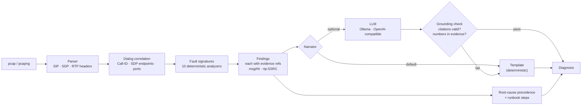

# sip-call-doctor

**Drop in a packet capture, get a diagnosis a Tier-1 engineer can act on: what broke, the exact packets that prove it, and what to change — with AI explanations that are not allowed to invent a single number.**

[](https://github.com/MarshalTakavinga/Agentic-Voice-AI/actions/workflows/sip-call-doctor.yml)


Project 02 of the [**Agentic Voice AI**](../README.md) portfolio. Runs entirely on a laptop.

---

## The problem

When a call fails or a customer reports "I can't hear them," a voice engineer opens Wireshark or sngrep, follows the SIP ladder, checks the SDP, and correlates RTP streams by hand. It takes experience and time, so Tier-1 escalates almost everything. Pasting a pcap into a general-purpose LLM doesn't fix this: models misread SDP, miss NAT, and confidently state jitter values that are nowhere in the capture.

## The approach: analyzers measure, the AI explains



Every finding carries the packets that prove it. The optional LLM narrator can rewrite the summary for readability, but its output is **rejected and replaced** unless every claim cites a real finding ID and every number it uses appears in the evidence.

## Example

```text
$ python -m sipdoc analyze captures/nat_one_way_audio.pcap

  #    +time  from                      to                      message
  1    0.00s  203.0.113.10:5060      -> 192.0.2.10:5060         INVITE (SDP)
  2    0.02s  192.0.2.10:5060        -> 203.0.113.10:5060       100 Trying
  3    0.50s  192.0.2.10:5060        -> 203.0.113.10:5060       180 Ringing
  4    2.00s  192.0.2.10:5060        -> 203.0.113.10:5060       200 OK (SDP)
  5    2.05s  203.0.113.10:5060      -> 192.0.2.10:5060         ACK
  6    7.20s  203.0.113.10:5060      -> 192.0.2.10:5060         BYE
  7    7.25s  192.0.2.10:5060        -> 203.0.113.10:5060       200 OK
     RTP 0x1a2b3c4d 203.0.113.10:16384 -> 192.0.2.10:20000  250 pkts  loss 0.0%  jitter 0.0 ms  MOS~4.4
     RTP 0x5e6f7a8b 192.0.2.10:20000 -> 192.168.1.50:16384  250 pkts  loss 0.0%  jitter 0.0 ms  MOS~4.4

DIAGNOSIS  Most likely cause: media sent to an unroutable address [F1]. 250 RTP packets were sent to
private address 192.168.1.50:16384, which is unreachable from the public internet. [F1]
Also observed: private address advertised in SDP [F2].
  !! [F1] critical Media sent to an unroutable address: ...
        evidence rtp:0x5e6f7a8b: RTP 192.0.2.10:20000 -> 192.168.1.50:16384, 250 packets
  !  [F2] major    Private address advertised in SDP: SDP advertises private media address
                   192.168.1.50 but the message arrived from public address 203.0.113.10 ...
        evidence msg#1: SDP c=192.168.1.50 in INVITE (SDP)
        evidence msg#1: signaling source 203.0.113.10:5060
  NEXT STEPS
   1. RTP is being sent to a private address learned from SDP ...
   2. Configure the PBX/SBC to rewrite it: Asterisk PJSIP `external_media_address`/`local_net`,
      FreeSWITCH `ext-rtp-ip`, or enable symmetric RTP ...
   3. Disable or correctly configure the firewall's SIP ALG; on FortiGate review the SIP session
      helper and VoIP profile ...
```

`--format mermaid` renders the same exchange as a sequence diagram, and `--format json` returns the full report. The exit code is `0` when no findings are raised and `1` otherwise, so the CLI drops into scripts.

## Fault signatures (Milestone 1)

| Signature | Detects | Key evidence |
|---|---|---|
| `auth_failure` | Digest challenge answered and rejected; 403; failed REGISTER | 401/407 → retried request with credentials → 403/401 |
| `codec_mismatch` | 488/606 with no common codec | Offered payload types vs rejection |
| `setup_timeout` | INVITE retransmitted with no final response; 408 | Retransmission count and span (RFC 3261 Timer A) |
| `call_rejected` | 4xx/5xx/6xx final responses (487 cancel is treated as normal) | Status and source |
| `nat_private_sdp` | SDP `c=` in RFC 1918 / CGNAT space while signaling came from a public address | `c=` line + signaling source |
| `media_to_private_address` | RTP sent to an unroutable private address | Stream destination |
| `one_way_audio` | Answered call with RTP missing in one or both directions | 200 OK + stream inventory |
| `rtp_packet_loss` | ≥1% minor, ≥5% major (sequence gaps, wraparound-aware) | Lost/expected per stream |
| `rtp_jitter` | ≥30 ms minor, ≥60 ms major (RFC 3550 interarrival jitter) | Mean and peak jitter |
| `large_udp_sip` | SIP over UDP above ~1300 bytes (fragmentation risk, RFC 3261 §18.1.1) | Message size |

Root-cause precedence: a failed setup explains everything after it; NAT explains one-way audio; media quality is considered last. MOS values are an **estimate** from a simplified E-model and assume zero one-way latency, because latency is not observable from a single capture point.

## Quick start

```bash
git clone https://github.com/MarshalTakavinga/Agentic-Voice-AI && cd Agentic-Voice-AI/02-sip-call-doctor
python -m venv .venv && source .venv/bin/activate     # Windows: .venv\Scripts\activate
pip install -r requirements.lock && pip install -e ".[dev]"

python -m sipdoc analyze captures/nat_one_way_audio.pcap
pytest                                  # 51 tests, coverage gate 90%
python scripts/run_evals.py             # detection report -> evals/latest_report.md
uvicorn sipdoc.api.app:app --port 8001  # API docs at http://localhost:8001/docs
```

Analyze your own capture the same way. To capture on a lab PBX: `tcpdump -i any -w call.pcap udp port 5060 or udp portrange 10000-20000`.

## API

```bash
curl -s -X POST localhost:8001/v1/analyses -H "X-API-Key: change-me-local-only" \
     -F capture=@captures/poor_quality.pcap | jq '.calls[0] | {root_cause, summary}'
```

```json
{
  "root_cause": "rtp_packet_loss",
  "summary": "Most likely cause: RTP packet loss [F1]. 7.66% loss (19 of 248 packets) on 192.0.2.10 -> 198.51.100.20; estimated MOS 3.67. [F1] Also observed: high RTP jitter [F2]."
}
```

| Endpoint | Purpose |
|---|---|
| `POST /v1/analyses` | Upload a capture (multipart, ≤20 MB default); returns the full report |
| `GET /v1/analyses/{id}` | Fetch a stored report |
| `GET /v1/analyses/{id}/calls/{call_id}/ladder?fmt=mermaid\|text` | SIP ladder |
| `GET /v1/signatures` | Signature catalog with runbook steps |
| `GET /health/live` · `GET /health/ready` · `GET /metrics` | Probes and Prometheus |

The spec is committed at [`docs/openapi.json`](docs/openapi.json).

## Evaluation

`scripts/generate_captures.py` builds 10 labeled pcaps with scapy (fixed seed, documentation IP ranges, fictional 555-01xx numbers): healthy call, NAT one-way audio, firewall one-way audio, codec mismatch, INVITE auth failure, REGISTER auth failure, setup timeout with an oversized INVITE, poor quality, busy, and caller cancel. Two are negative controls that must produce **no** findings.

Current result: **10/10 exact matches, 0 false positives, 0 false negatives** ([report](evals/latest_report.md)).

This is a regression baseline, not an accuracy claim. These captures were written alongside the analyzers, so passing them proves the analyzers behave as designed. Milestone 2 adds captures from a real Asterisk/FreeSWITCH lab with injected faults (`tc netem` for loss and jitter), and that is where precision and recall become meaningful.

## What is real and what is simulated

| Component | Status |
|---|---|
| pcap/pcapng parsing, SIP/SDP parsing, RTP statistics, dialog correlation | **Implemented & tested** on generated captures |
| 10 fault signatures, root-cause ranking, runbooks | **Implemented & tested** on generated captures |
| Template narrator + grounding check | **Implemented & tested** |
| LLM narrator (OpenAI-compatible) | **Simulated**: tested with a mocked HTTP transport, including a hallucination that gets rejected |
| Real PBX / carrier captures | **Not yet validated** (Milestone 2) |

## Design decisions

| Decision | Why |
|---|---|
| Deterministic analyzers, LLM optional | Diagnoses must be reproducible and auditable; an engineer must be able to verify every claim against a packet. |
| Grounding check on LLM output | Turns "the model usually behaves" into a tested guarantee: no uncited claim and no invented number reaches the user. |
| NAT detection uses RFC 1918/CGNAT/ULA explicitly | Python's `ipaddress.is_private` also flags documentation and benchmarking ranges, which would hide NAT faults. A test pins this. |
| RTP payloads never read past the 12-byte header | Captures can contain call audio; the analyzer has no use for it. |
| Phone numbers masked in reports and logs | Captures are full of PII; reports keep only the last four digits. |
| Streams matched by SDP address, then port | NAT rewrites addresses but usually preserves ports, so correlation still works when the fault itself is NAT. |

## Security

Uploads are written to a private temporary directory, parsed, and deleted before the response is returned; only the derived report is kept, in a bounded in-memory store. See [SECURITY.md](SECURITY.md), including why parsing untrusted pcaps should be sandboxed in production.

## Roadmap

| Milestone | Scope | Status |
|---|---|---|
| **1. Evidence-first analyzer** | Parser, 10 signatures, grounded narrator, CLI, API, evals, CI | ✅ this release |
| 2. Lab-validated detection | Docker lab with Asterisk + FreeSWITCH + SIPp; `tc netem` fault injection; labeled real captures; precision/recall per signature | Planned |
| 3. Investigator agent | LangGraph agent that requests more analysis as tools (re-INVITE/hold, SRTP, DTMF RFC 2833 vs in-band, SIP over TCP/TLS) | Planned |
| 4. Live ingestion | HEP/Homer feed, fleet-level correlation with `voip-quality-sentinel` | Planned |

## License

MIT. Synthetic captures only.
