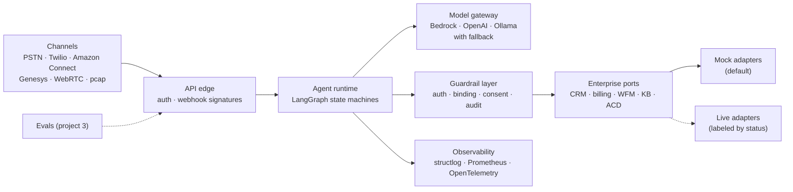

# Agentic Voice AI

**AI agents that are safe to put on a phone line — and the tooling to debug the phone line too.**

A portfolio of ten projects applying agentic AI to VoIP, IVR and contact-center modernization, by **Marshal Takavinga**. Each numbered folder is an independently runnable project with its own README, tests and CI workflow.

[](https://github.com/MarshalTakavinga/Agentic-Voice-AI/actions/workflows/ivr.yml)
[](https://github.com/MarshalTakavinga/Agentic-Voice-AI/actions/workflows/sip-call-doctor.yml)
[](https://github.com/MarshalTakavinga/Agentic-Voice-AI/actions/workflows/demo.yml)

---

## The portfolio

| # | Project | What it does | Tier | Status | Folder |
|---|---|---|---|---|---|
| 1 | **Agentic Voice IVR** | Conversational IVR that verifies callers, completes multi-step requests through guarded tool calls, and warm-transfers with context | Flagship | ✅ Milestone 1 built | [`01-agentic-voice-ivr/`](01-agentic-voice-ivr) |
| 2 | **SIP Call Doctor** | Diagnoses one-way audio, NAT, codec, auth and quality faults from packet captures, with evidence-cited AI explanations | Flagship | ✅ Milestone 1 built | [`02-sip-call-doctor/`](02-sip-call-doctor) |
| 3 | Voice Agent Evals | Regression and load testing: task completion, p95 latency, prompt-injection resistance | Advanced | Planned | [`03-voice-agent-evals/`](03-voice-agent-evals) |
| 4 | Contact Center Copilot | Real-time agent assist with permission-aware cited RAG and after-call summaries | Flagship | Planned | [`04-contact-center-copilot/`](04-contact-center-copilot) |
| 5 | Voice PII Guard | Redacts PII across call audio, transcripts, logs and LLM tool payloads | Advanced | Planned | [`05-voice-pii-guard/`](05-voice-pii-guard) |
| 6 | Contact Center Tool Gateway | MCP server exposing CRM/ACD actions with scopes, consent and audit | Intermediate | Planned | [`06-cc-tool-gateway/`](06-cc-tool-gateway) |
| 7 | Voice Agent Orchestrator | Supervisor + specialist agents with least-privilege tools per specialist | Advanced | Planned | [`07-voice-agent-orchestrator/`](07-voice-agent-orchestrator) |
| 8 | IVR Modernizer | Converts legacy DTMF/VoiceXML trees into conversational flows with provable path coverage | Intermediate | Planned | [`08-ivr-modernizer/`](08-ivr-modernizer) |
| 9 | VoIP Quality Sentinel | Anomaly detection on MOS, jitter, loss and PDD, linked to packet-level evidence | Advanced | Planned | [`09-voip-quality-sentinel/`](09-voip-quality-sentinel) |
| 10 | Smart Call Router | Explainable routing recommendations evaluated in a discrete-event simulator | Intermediate | Planned | [`10-smart-call-router/`](10-smart-call-router) |

"Planned" folders contain the specification and a starter skeleton only. Status changes here only when the code exists and its CI is green.

## Interactive demo

Try projects 01 and 02 in your browser: call the IVR and watch its state and tool audit trail update every turn, or diagnose sample SIP captures and see packet-cited findings with ladder diagrams.

```bash
pip install -r demo/requirements.txt
streamlit run demo/streamlit_app.py
```

See [`demo/`](demo) for details and for publishing a free public link on Streamlit Community Cloud.

## Design principles behind every project

| Principle | In practice |
|---|---|
| **Guardrails in code, not prompts** | Authorization, identity binding and consent for side effects are enforced by the tool layer and proven by tests. Models propose; code decides. |
| **Measure deterministically, explain with AI** | Identifiers and measurements come from deterministic code. LLM output is accepted only when grounded, with automatic fallback when it isn't. |
| **Honest engineering** | Each README separates what is tested live from what is simulated. Eval results come from CI, with their limits stated. |
| **Runs on a laptop** | Synthetic data and mock adapters by default; no paid account is needed to evaluate the work. Cloud adapters sit behind the same interfaces. |
| **Privacy by default** | Credentials leave state after use; phone numbers and digit runs are redacted from logs and reports; audio payloads are never stored. |

## Shared architecture



## Try it

```bash
git clone https://github.com/MarshalTakavinga/Agentic-Voice-AI && cd Agentic-Voice-AI

# 01: talk to the IVR in your terminal
cd 01-agentic-voice-ivr
pip install -r requirements.lock && pip install -e ".[dev]"
python scripts/simulate_call.py
cd ..

# 02: diagnose a NAT one-way-audio capture
cd 02-sip-call-doctor
pip install -r requirements.lock && pip install -e ".[dev]"
python -m sipdoc analyze captures/nat_one_way_audio.pcap
```

Use a separate virtual environment per project; each pins its own dependencies.

## Repository layout

```text
01-…/ to 10-…/        one project per folder: own README, pyproject, tests, Dockerfile
.github/workflows/    one CI workflow per built project, triggered only by changes to its folder
demo/                 Streamlit app running projects 01 and 02 in the browser
docs/                 portfolio strategy, roadmap and reference material
```

## About

Cloud and enterprise architect (Azure Solutions Architect Expert, AWS Professional-level certified) with a background in network engineering — routing, SD-WAN, firewalls and telecom operations — completing an M.S. in Information Systems Technology at George Washington University.

## License

MIT. All data in this repository is synthetic.
